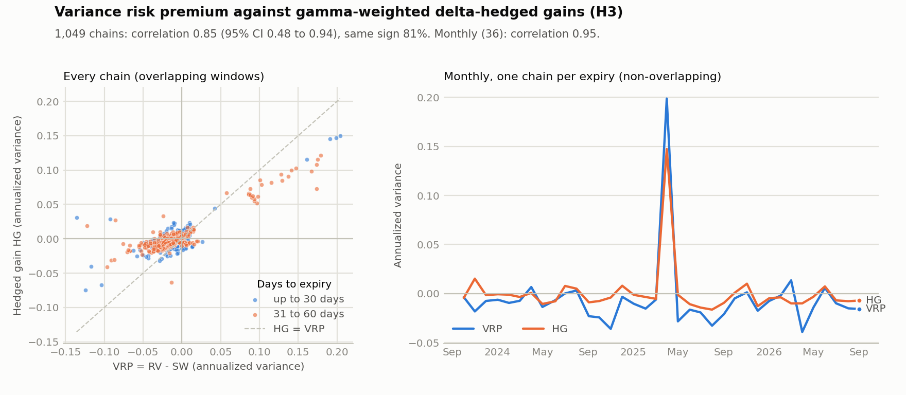

# The variance risk premium in E-mini S&P 500 futures options

<!-- DRAFT. Every value in [[double brackets]] is provisional, from the 20 Oct 2026 run on older code.
     Replace each one from reports/tables/ after the final run, then delete this comment. -->

**ES options are priced above the volatility that follows, but the premium sits in the skew: delta-hedged
near-the-money options earn about nothing, and a monthly short straddle loses money after costs.**

Using three years of CME data from Databento (October 2023 to September 2026), we measure the variance
risk premium in end-of-month E-mini S&P 500 options two independent ways and then test whether a
systematic option seller could have collected it.

## Headline results

| Hypothesis | Result |
|---|---|
| **H1** Implied variance exceeds realized (VRP < 0) | **Supported in log terms.** Options implied [[17.7%]] volatility on the 30-day series against [[15.7%]] realized; the premium was negative on [[86%]] of days. Mean ln(RV/SW) = [[−0.52]], Newey–West t = [[−6.4]]. In variance units the mean is [[−0.0072]] but not significant (t = [[−1.6]]): one episode, April 2025, dominates |
| **H2** Hedged option gains are negative, larger near the money and in high-volatility regimes | [[PENDING: bucket table, reports/tables/summary.csv]] |
| **H3** The two measures agree in sign and co-move | **Partly.** Signs agree in [[89%]] of months and the monthly correlation is [[0.95]], but [[0.45]] without April 2025 (Spearman [[0.56]]). Hedged gains are close to zero ([[+0.0007]]) while the VRP is [[−0.0057]]; the gap is the skew |
| **H4** A short delta-hedged straddle earns the premium after costs | **Not supported.** [[32]] monthly trades: [[−0.16]] vol points per unit vega before costs, [[−1.01]] after; net Sharpe [[−0.78]], skew [[−2.4]]; worst month April 2025 ([[−$12,200]] on one straddle) |



*Each point is one option expiry on one day: the Carr–Wu premium (x) against the gamma-weighted hedged
gain (y). Points above the 45° line are expiries where hedged options lost less than the strip implies.*

## What we found

**The premium is real, but it is a premium for crash protection.** The swap rate weights every strike by
1/K², so out-of-the-money puts carry much of it. Hedged options near the money only collect the
difference between at-the-money implied and realized variance. Splitting the gap between the two
measures shows that the skew term, SW − IV²_gw, averages [[0.0079]], which accounts for nearly all of the
difference. Investors pay most for protection against large declines, not for volatility in general.

**One month can decide a variance statistic.** The 30-day windows that start in late March 2025 run into
the April 2025 tariff selloff, when realized volatility reached about [[49%]] against roughly [[17%]]
implied. That single episode turns the variance-unit premium insignificant, inflates the H3 correlation,
and produces the strategy's worst month. Log premia and rank correlations are far less sensitive to it,
which is why we report both.

**Selling at-the-money straddles is not the way to harvest it.** Before costs the straddle earns about
zero per unit of vega; spreads, hedge slippage and fees turn that negative, and the return is strongly
left-skewed. [[Robustness, reports/tables/robustness.csv: cost multiplier, bid/mid/ask strip, hedge delta]]

## How it works

1. **Data.** Databento `GLBX.MDP3`: option definitions, 1-minute best bid and offer at 15:00 CT each day,
   and 1-minute bars and settlements for the ES futures each option is written on. End-of-month (EW)
   options are European, so Black-76 prices them exactly.
2. **Chains.** Quotes are cleaned (crossed, zero-bid, below-intrinsic quotes and thin chains removed),
   the forward is implied from put–call parity, and implied volatilities and Greeks are computed.
3. **Carr–Wu (2009).** A model-free variance swap rate SW is built from out-of-the-money options and
   compared with realized variance RV from 5-minute returns: VRP = RV − SW.
4. **Bakshi–Kapadia (2003).** Every option within 10% of the money and 14–60 days from expiry is bought
   and delta-hedged daily with its futures contract to expiry.
5. **Inference.** Overlapping 30-day windows make naive t-statistics far too large, so all tests use
   Newey–West errors or non-overlapping monthly samples.

Derivations are in [docs/theory.md](docs/theory.md); each stage is documented in [docs/stages/](docs/stages/).

## Limitations

- Three years of data, dominated by one volatility episode.
- One snapshot per day at 15:00 CT, the ES settlement minute, when near-the-money quotes are often wide or
  one-sided; [[4]] strategy months had no tradable straddle.
- [[One line per issue closed as a decision: collect with
  `gh search issues "README limitation" --repo SilarTanwir/FINM37000_GROUP5`]]

## How to run

You need Python 3.11+ and a Databento API key with access to `GLBX.MDP3`.

```bash
git clone https://github.com/SilarTanwir/FINM37000_GROUP5.git && cd FINM37000_GROUP5
python -m venv .venv && source .venv/bin/activate
pip install -e ".[dev]"
cp .env.example .env              # then set DATABENTO_API_KEY in .env
pytest -q                         # offline tests, no key needed
doit universe quotes underlying chain vrp hedging analysis report
```

- **Cost.** Every request logs Databento's cost estimate before pulling and stops if it exceeds
  `data.budget_usd` in `config/default.yaml` (default $50 per request). On our Databento Plus plan every
  pull was estimated at $0; we have not checked the price on other plans.
- **Runtime.** A first run downloads everything; the futures bars alone (stage 3) took about 50 minutes.
  Pulls are cached in `data/`, so reruns take [[minutes]].
- **Outputs.** Intermediate tables in `data/` (Parquet, not committed: Databento data is licensed);
  results in `reports/tables/` (CSV) and `reports/figures/` (PNG). Parameters are in
  `config/default.yaml`; `doit list` shows every stage.

## Repository layout

```
src/esvrp/      data/ (Databento client, universe, quotes, futures) · pricing/ (Black-76, forward, chain)
                vrp/ (strip, realized variance, premium) · hedging/ (simulator, costs)
                analysis/ (inference, H3, strategy) · reporting/
config/         default.yaml, every tunable parameter
tests/          offline tests (pytest)
docs/           theory.md, data.md, stages/, PLANNING.md and DEVELOPER_NOTES.md (the original plan)
reports/        tables/ and figures/ written by the pipeline
```

FINM 37000 Group 5: Tanwir Silar, Alex Nikolaev, Aryaa Gunavante, Andrew Yang.
